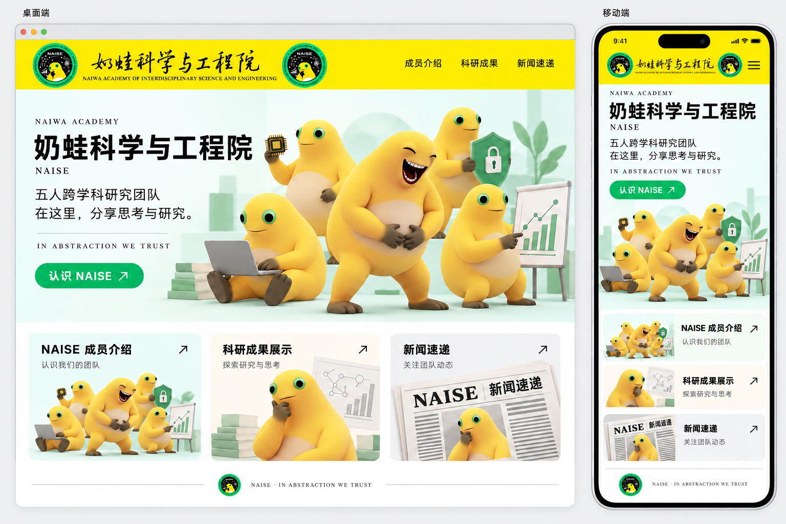

# NAISE 网站主页设计说明

## 一、主页定位

NAISE（Naiwa Academy of Interdisciplinary Science and Engineering，奶蛙科学与工程院）是一个五人跨学科研究团队，主要研究奶蛙。主页用于介绍团队、展示科研成果和发布新闻动态。

页面以奶蛙群像作为主视觉，通过黄色导航栏、绿色按钮、黑色文字和浅色背景，兼顾科研展示的清晰感与奶蛙形象的趣味。主页设置三个明确入口：**NAISE 成员介绍、科研成果展示、新闻速递**。

## 二、整体视觉

- **黄色**：用于顶部导航栏，与奶蛙的黄色皮肤呼应。
- **绿色**：用于主要按钮、院徽及部分科研道具。
- **黑色**：用于标题、正文、导航和箭头，保证文字清晰。
- **白色与浅色背景**：用于页面底色、卡片和留白；主视觉区域以浅薄荷绿衬托角色。

标题使用醒目的黑色粗体，正文保持简洁。插画采用柔和的三维质感，角色皮肤平滑，以明暗表现体积。各区域通过留白、浅色块和细分隔线组织层次。

## 三、桌面端布局

页面从上到下依次为：顶部导航栏、主视觉区域、三个入口卡片和页脚。

### 1. 顶部导航栏

导航栏为通栏黄色背景。左侧展示普通版本 LOGO，包括黑色中文书法字、英文名称及两侧院徽，可以直接把之前的svg拿来用；右侧依次为「成员介绍」「科研成果」「新闻速递」。

### 2. 主视觉区域

主视觉采用左右布局：左侧介绍团队，右侧展示五只奶蛙组成的群像。

左侧文字包括：

- NAIWA ACADEMY
- 奶蛙科学与工程院
- NAISE
- 五人跨学科研究团队
- 在这里，分享思考与研究。
- IN ABSTRACTION WE TRUST

文字下方设置绿色圆角按钮「认识 NAISE ↗」。中文院名是主要标题，团队介绍和格言作为辅助信息。

右侧五只奶蛙前后错落，中央角色最突出：

| 位置 | 动作与道具 |
| --- | --- |
| 中央前景 | 站立，略微侧身并向前倾，闭眼张嘴，双手捧着白色大肚子大笑。 |
| 左后方 | 手持芯片，融入微电子元素。 |
| 右后方 | 手持带锁的绿色盾牌，融入网络安全元素。 |
| 右前方 | 指向图表，融入商科元素。 |
| 左前方 | 坐着使用电脑，融入计算机科学元素。 |

这些元素只通过道具表达，角色旁不标注专业名称，页面也不设置专业名称展示条。

### 3. 三个入口卡片

主视觉下方横向排列三张卡片，分别以标题、简短说明、插画和右上角箭头构成入口。

| 入口 | 辅助文字 | 插画内容 |
| --- | --- | --- |
| NAISE 成员介绍 | 认识我们的团队 | 五只奶蛙组成群像，中央一只略微侧身、闭眼张嘴，双手捧腹大笑。 |
| 科研成果展示 | 探索研究与思考 | 一只奶蛙用一只手抵住下巴，呈思考姿态；书籍和研究图示作为辅助。 |
| 新闻速递 | 关注团队动态 | 报纸头版的局部，奶蛙以彩色刊印图片出现在版面中，保持托腮思考姿态。 |

新闻插画中的奶蛙仅存在于报纸图片内部，不拿着报纸，也不从报纸后探头。报纸以「NAISE」「新闻速递」和示意排版线条构成，不编写具体新闻事件。

### 4. 页脚

页脚以细线、院徽和「NAISE · IN ABSTRACTION WE TRUST」收尾，保持简洁。

## 四、移动端布局

移动端沿用桌面端的配色、字体层级、角色画风和内容顺序，根据屏幕宽度重新排布。

1. 顶部保留黄色导航栏和普通版本 LOGO，右侧使用菜单图标。
2. 主视觉改为上下布局：团队文字与按钮在上，五只奶蛙群像在下。
3. 群像保留中央捧腹大笑的角色及其余四只角色的道具，保证角色数量、表情和动作可辨认。
4. 三个入口卡片纵向排列，每张卡片采用左侧插画、右侧标题与说明的布局，并保留入口箭头。
5. 页脚保留院徽与格言。

移动端不直接缩小整张桌面页面，而是重新安排文字、插画和卡片的位置，保证阅读与识别清楚。

## 五、奶蛙形象要求

所有奶蛙以原始形态说明和三张原始参考图为造型依据，保持相同的角色结构。

- 黄色皮肤、白色大肚子，身体肥大，四肢相对短粗。
- 头部较窄，头顶圆钝，与肩背连续过渡，没有明显细脖子或独立球形头。
- 睁眼时，眼睛只包含绿色眼白和黑色眼珠，没有白色眼白，也没有眉毛。
- 大笑时，两条闭眼弧线就是眼睛，不在其上方增加眉毛；同时张嘴并双手捧腹。
- 思考时，一只手抵住下巴，嘴闭合，表情通过眼睛、嘴线和动作表达。
- 手脚末端为深灰褐色，手指圆钝，脚部扁宽并具有脚蹼特征。
- 不增加原图中没有的蛙吻、宽大蛙嘴、眼柄、鳞片或疣粒。

## 六、当前图片素材

本目录包含一张整体参考图和四张独立素材。整体参考图用于说明页面布局；独立素材用于对应区域的插画展示。

| 文件 | 用途 |
| --- | --- |
| [主页设计参考.png](主页设计参考.png) | 同时展示桌面端和移动端的页面参考。 |
| [主视觉.png](主视觉.png) | 五只奶蛙与四类道具组成的主视觉，当前为白色背景。 |
| [成员介绍图标.png](成员介绍图标.png) | 成员介绍入口的五只奶蛙群像。 |
| [科研成果图标.png](科研成果图标.png) | 科研成果入口的思考形态奶蛙与研究道具。 |
| [新闻速递图标.png](新闻速递图标.png) | 新闻入口的报纸头版局部与刊印奶蛙图片。 |

主页参考中不虚构成员姓名、论文、成果数量或新闻事件。
